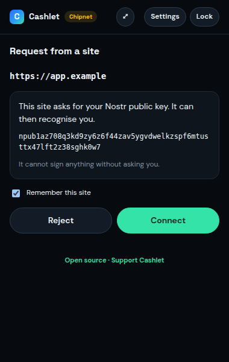
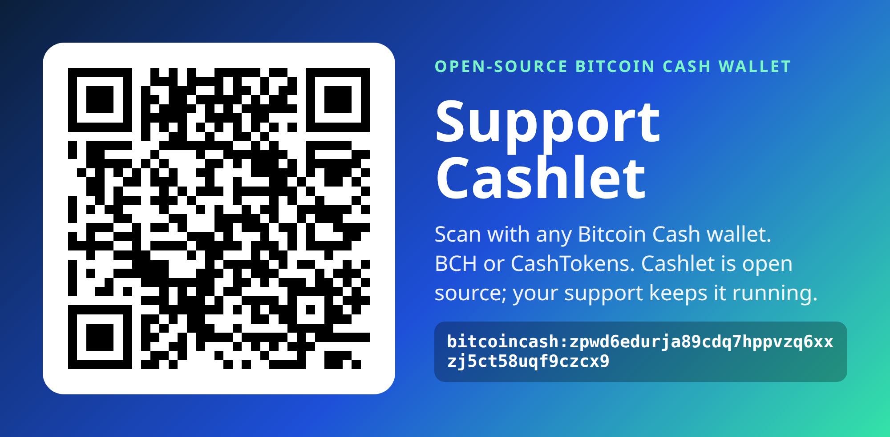

# Cashlet

A self-custodial Bitcoin Cash wallet for the browser, with CashTokens, Nostr
signing and BND identity: bind your wallet to your Nostr key, get paid by npub
or did:bnd, and log in to sites with your keys.

This is the first release (v0.1.0). It runs on **chipnet**, the Bitcoin Cash
test network, by default. Use test coins only.

<p>
  
  
  
  
  
</p>

## Install

1. Download `cashlet-v0.1.0.zip` from the
   [releases page](https://github.com/cashlet-labs/cashlet-wallet/releases) and
   unzip it.
2. Open `chrome://extensions`, turn on **Developer mode**, choose
   **Load unpacked** and select the unzipped folder.
3. Pin Cashlet from the extensions menu. The ◧ and ⤢ buttons in the top bar
   open the wallet in the side panel or in a full tab.

## Try it in five minutes

1. Create a wallet, write down the twelve words and set a password.
2. Open **Receive**, copy the `bchtest:` address and get test coins from the
   [chipnet faucet](https://tbch.googol.cash/).
3. Open **Identity** and publish it. This binds the wallet's address to its
   Nostr key, so anyone can pay you by your `npub` or `did:bnd`.
4. Open **Send** and paste an `npub1…` or `did:bnd:chipnet:…` instead of an
   address. The wallet resolves it, checks the binding and shows the address
   it found before you confirm.
5. Log in at [bnd.septemlabs.com](https://bnd.septemlabs.com) with the wallet.
   The site gets a signed answer to its challenge, never your keys.
6. Under **Apps**, connect a dapp with WizardConnect and approve or reject what
   it asks the wallet to sign.

## Security and privacy

- The recovery phrase is encrypted with a key derived from your password
  (PBKDF2-SHA-256 and AES-256-GCM) and
  never stored in the clear. The wallet locks itself after a while.
- Sites get nothing until you approve them, and every signature or
  transaction asks first. You can disconnect any site under Settings.
- Dapp transactions are checked before you see them: the wallet refuses a
  transaction with a fee above 0.01 BCH that takes more than half of what it
  spends, and warns about any fee above 10 sat/byte or 1% of the amount.
- There is no Cashlet server, account or analytics. The wallet talks to
  public Electrum servers for the chain and to Nostr relays for identity.

## For websites

On https pages (and `localhost` for development) the wallet provides:

- `window.nostr`, the NIP-07 signer: `getPublicKey()`, `signEvent(event)` and
  `getRelays()`. A site must be approved before it gets the key, and every
  signature is approved unless the user chose "don't ask again" for that
  event kind on that site. Profile, follow-list, relay-list, deletion and login
  events always ask. Sites cannot sign BND bindings.
- `window.bnd.login(challenge)`, which answers a BND login challenge
  (`issueChallenge` in [`@cashlet-labs/bnd`](https://www.npmjs.com/package/@cashlet-labs/bnd))
  with the wallet's identity. The challenge's audience must be on the page's
  own origin. Send the result to your server and check it with `verifyLogin`.

Connected sites are listed, and can be disconnected, under Settings.

## Development

Node.js 22 or later.

```bash
npm install
npm run build        # builds dist/ and checks it
npm run dev          # rebuilds dist/ on every change
```

Load `dist/` in Chrome: open `chrome://extensions`, turn on Developer mode,
choose **Load unpacked** and select the `dist` folder.

## Checks

```bash
npm run check        # everything below, in order
npm run typecheck
npm run lint
npm run format:check
npm test             # unit tests
npm run build        # also fails on shipped source maps or top-level await in the service worker
npm run test:e2e     # loads the built extension in Chromium
```

README screenshots: `SCREENSHOTS=1 npx playwright test screenshots`.

There is no hosted CI yet; run `npm run check` before opening a pull request.
The first `test:e2e` run needs a browser: `npx playwright install chromium`.

## Support Cashlet

Cashlet is open source and free. Gifts keep it running:

`bitcoincash:zpwd6edurja89cdq7hppvzq6xxzj5ct58uqf9czcx9`

The same address is on the wallet's support page.



## Licence

MIT. See [LICENSE](LICENSE).
