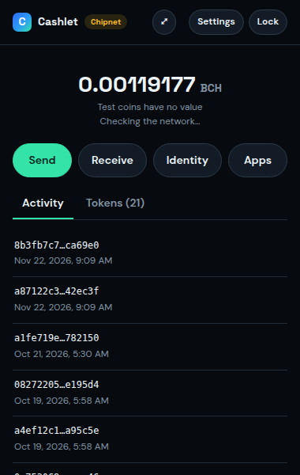
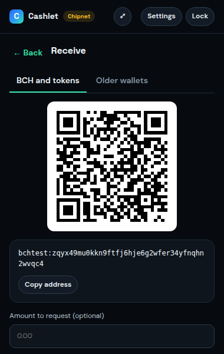
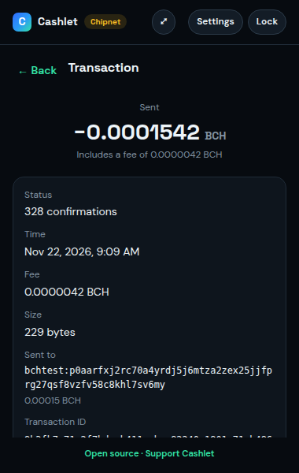
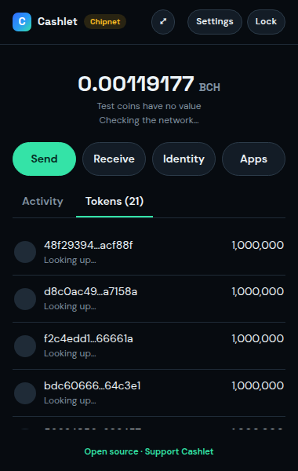
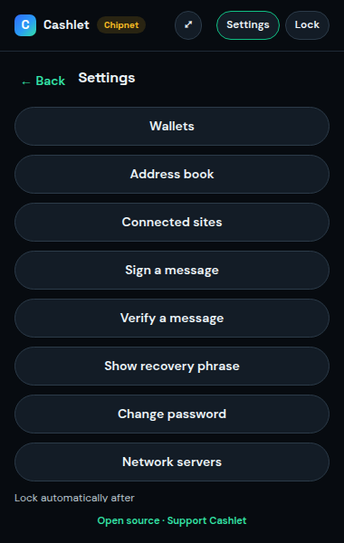
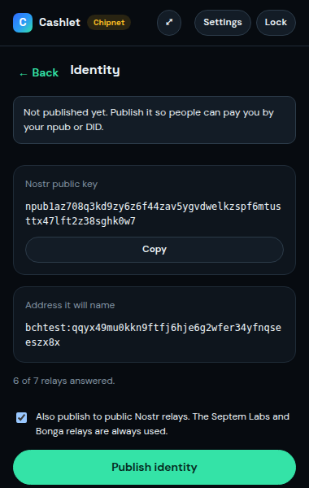
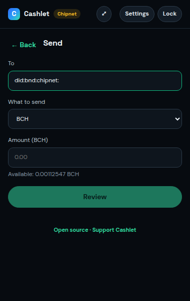
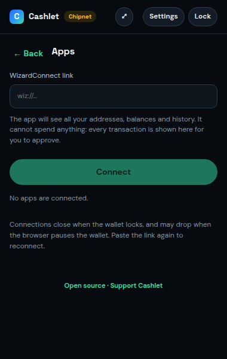

# Cashlet

A self-custodial Bitcoin Cash wallet for the browser, with CashTokens, Nostr
signing and BND identity: bind your wallet to your Nostr key, get paid by npub
or did:bnd, and log in to sites with your keys.

New wallets use mainnet. To try Cashlet with free test coins, open
**Developer options** when you create or restore a wallet and tick
**Use chipnet, the test network**.

<p>
  
  
  
  
  
  
  
  
  
</p>

## Features

- Send and receive BCH and CashTokens. Receive shows a token-aware address by
  default. **Max** sends the whole BCH balance and never touches token coins.
- Token names, symbols, decimals and icons from each token's on-chain BCMR
  registry, checked against the hash published on chain.
- Prices in 12 currencies, or off. Chipnet wallets fetch no prices.
- Transaction detail: direction, amount, fee, confirmations, where it went,
  and a link to a block explorer.
- Settings for the fee rate (1 to 10 sat/byte) and a preferred Electrum server.
- Several wallets under one password, switched in **Settings → Wallets**.
- Bitcoin signed messages: sign with your identity or receive address, and
  verify anyone's.
- BND identity: publish, rotate and revoke the binding of your address to your
  Nostr key. Pay anyone by `npub` or `did:bnd`.
- For websites: a Nostr signer (NIP-07, NIP-04, NIP-44) and BND login, each
  approved by you.
- WizardConnect: a site's `wiz://` link is picked up from the page, and you
  approve the connection and every transaction.
- Popup, side panel or full-tab views.

## Install

1. Download [`cashlet.zip`](https://github.com/cashlet-labs/cashlet-wallet/releases/latest/download/cashlet.zip) from the
   [releases page](https://github.com/cashlet-labs/cashlet-wallet/releases) and
   unzip it.
2. Open `chrome://extensions`, turn on **Developer mode**, choose
   **Load unpacked** and select the unzipped folder.
3. Pin Cashlet from the extensions menu. The ◧ and ⤢ buttons in the top bar
   open the wallet in the side panel or in a full tab.

## Try it in five minutes

1. Create a wallet. Under **Developer options**, tick **Use chipnet**, then
   set a password and write down the twelve words.
2. Open **Receive**, copy the `bchtest:` address and get test coins from the
   [chipnet faucet](https://tbch.googol.cash/).
3. Open **Identity** and publish it. This binds the wallet's address to its
   Nostr key, so anyone can pay you by your `npub` or `did:bnd`.
4. Open **Send** and paste an `npub1…` or `did:bnd:chipnet:…` instead of an
   address. The wallet resolves it, checks the binding and shows the address
   it found before you confirm.
5. Log in at [bnd.septemlabs.com](https://bnd.septemlabs.com) with the wallet.
   The site gets a signed answer to its challenge, never your keys.
6. Open a dapp that offers WizardConnect. Cashlet finds its `wiz://` link and
   asks whether to connect. You can also paste the link under **Apps**. Every
   transaction the dapp asks for is shown for approval.

## Security and privacy

- One password unlocks every wallet in Cashlet. Switch wallets under
  **Settings → Wallets**.
- The recovery phrase is encrypted with a key derived from your password
  (PBKDF2-SHA-256 and AES-256-GCM) and
  never stored in the clear. The wallet locks itself after a while.
- Sites get nothing until you approve them, and every signature or
  transaction asks first. You can disconnect any site under Settings.
- Dapp transactions are checked before you see them: the wallet refuses a
  transaction with a fee above 0.01 BCH that takes more than half of what it
  spends, and warns about any fee above 10 sat/byte or 1% of the amount.
- There is no Cashlet server, account or analytics. The wallet talks to
  public Electrum servers for the chain and to Nostr relays for identity.
  Besides those, the security policy lists exactly three hosts: one IPFS
  gateway for token registries and icons, and two price sources. Registries
  hosted elsewhere are not fetched, and those tokens show their short id.

## For websites

On https pages (and `localhost` for development) the wallet provides:

- `window.nostr`, the NIP-07 signer: `getPublicKey()`, `signEvent(event)` and
  `getRelays()`. A site must be approved before it gets the key, and every
  signature is approved unless the user chose "don't ask again" for that
  event kind on that site. Profile, follow-list, relay-list, deletion and login
  events always ask. Sites cannot sign BND bindings.
- `window.nostr.nip04` and `window.nostr.nip44`, each with `encrypt(pubkey, plaintext)`
  and `decrypt(pubkey, ciphertext)`. The site must be connected first, and each call
  is approved unless the user chose "don't ask again" for that method on that site.
  The wallet shows the other key and, when encrypting, the text.
- `window.bnd.login(challenge)`, which answers a BND login challenge
  (`issueChallenge` in [`@cashlet-labs/bnd`](https://www.npmjs.com/package/@cashlet-labs/bnd))
  with the wallet's identity. The challenge's audience must be on the page's
  own origin. Send the result to your server and check it with `verifyLogin`.

Connected sites are listed, and can be disconnected, under Settings.

Settings also has **Sign a message** and **Verify a message** for Bitcoin Signed Messages
(a base64 signature that proves an address is yours). Sites cannot ask for these.

## Development

Node.js 22 or later.

```bash
npm install
npm run build        # builds dist/ and checks it
npm run dev          # rebuilds dist/ on every change
```

Load `dist/` in Chrome: open `chrome://extensions`, turn on Developer mode,
choose **Load unpacked** and select the `dist` folder.

## Checks

```bash
npm run check        # everything below, in order
npm run typecheck
npm run lint
npm run format:check
npm test             # unit tests
npm run build        # also fails on shipped source maps or top-level await in the service worker
npm run test:e2e     # loads the built extension in Chromium
```

README screenshots: `SCREENSHOTS=1 npx playwright test screenshots`.

There is no hosted CI yet; run `npm run check` before opening a pull request.
The first `test:e2e` run needs a browser: `npx playwright install chromium`.

## Support Cashlet

Cashlet is open source and free. Gifts keep it running:

`bitcoincash:zpwd6edurja89cdq7hppvzq6xxzj5ct58uqf9czcx9`

The same address is on the wallet's support page.


## Licence

MIT. See [LICENSE](LICENSE).
